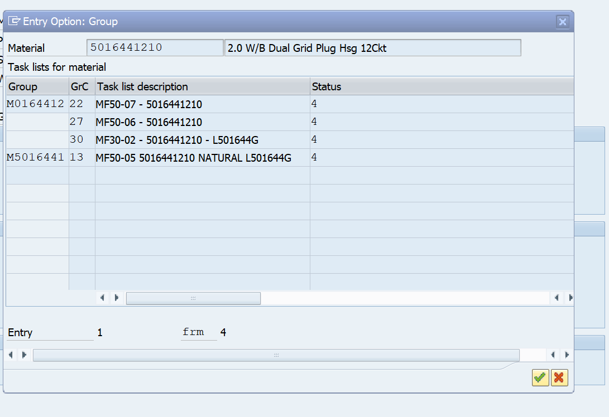
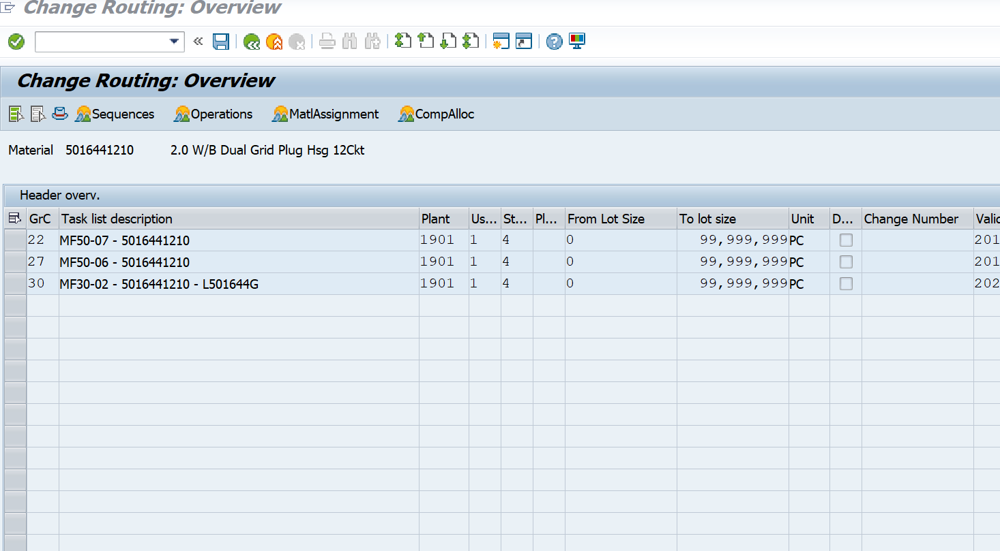

# CA02 - Assign new BOM components to routings

For every routing of a material, assigns the unassigned components of the
newly created BOM (from `create_main.py`) to an operation in CA02:

- **0030** if the component description contains a packaging word
  (carton, sheet, bag, silica, bubble, box)
- **0020** for every other component

The list of routings comes from Snowflake (MLX_DATALAKE). Each routing is opened,
assigned and saved on its own, so there is no backtracking between routings.

| File | Role |
|---|---|
| `routing_main.py` | Runner. Reads the Excel, gets the routings from Snowflake, loops routings, writes results. **Run this.** |
| `routing.py` | SAP screen steps (CA02). `python routing.py` tests one routing (5016441210, M0164412 / 22). |
| `routing_sf.py` | Snowflake query: list of routings per material. |
| `models.py` | `Routing` dataclass (material, group, GrC, description, status, message). |

- **Input:** result file of `create_main.py` (`create_bom_final.xlsx`), rows with `STATUS = SUCCESS`.
- **Output:** `create_bom_final_routing.xlsx`, one row per routing:
  `Material`, `Group`, `GrC`, `Description`, `STATUS`, `MESSAGE`. The input file is not changed.

---

## Logic flow

```
CONNECT to SAP
READ Excel file
SET materialList to unique Parent Materials WHERE STATUS = SUCCESS
SET routingList to routings of materialList FROM Snowflake   # material, group, GrC, description

FOR EACH routing IN routingList
    TRY
        GO TO CA02
        ENTER material and 1901, PRESS Enter

        IF group popup is shown THEN
            FIND row WHERE Group = routing.group
            IF not found THEN RAISE "Group not found" END IF
            DOUBLE-CLICK that row
        END IF

        FIND header row WHERE GrC = routing.GrC
        IF not found THEN RAISE "GrC not found" END IF
        DOUBLE-CLICK that row

        PRESS btn[7], DOUBLE-CLICK BOM row 8          # component allocation opens

        # Pass 1: packaging -> 0030
        SELECT rows WHERE operation is empty AND description is packaging
        IF any selected THEN
            PRESS btn[5], TYPE "0030", PRESS Enter
        END IF

        # Pass 2: everything still unassigned -> 0020
        SELECT rows WHERE operation is empty
        IF any selected THEN
            PRESS btn[5], TYPE "0020", PRESS Enter
        END IF

        IF nothing was assigned THEN
            SET status to SKIPPED                     # no save, next /NCA02 leaves the screen
        ELSE
            PRESS Save
            SET status to SUCCESS
        END IF
    CATCH error
        SET status to FAILED, message to error text
    END TRY

    WRITE results to Excel
END FOR
```

One routing = one CA02 entry = one save. A failure only affects that routing;
the run continues with the next one.

---

## Step 1 - Routing list from Snowflake (`routing_sf.py`)

`load_routings(materials)` returns one `Routing` per material + group + GrC at plant 1901.

| Filter | Why |
|---|---|
| `pk.WERKS = '1901'` | Plant 1901 |
| `mp.PLNTY = 'N'` | Standard routings only (CA02). `Q` = rate routing, edited in CA22, not shown in the CA02 popup. |
| `pk.LOEKZ`, `mp.LOEKZ` blank | Routing and material assignment not marked for deletion |
| `DW_SOFT_DELETE_FLAG = 0` | Not deleted in the data lake |
| `QUALIFY ROW_NUMBER() ... ORDER BY pk.ZAEHL DESC = 1` | PLKO can hold several change states of one routing; keep the latest so a routing is never processed twice |

No PLAS / PLPO / CRHD join: those are per operation / work center and would
repeat every routing.

Example for 5016441210 (matches the SAP popup below):

| Material | Group | GrC | Description |
|---|---|---|---|
| 5016441210 | M0164412 | 22 | MF50-07 - 5016441210 |
| 5016441210 | M0164412 | 27 | MF50-06 - 5016441210 |
| 5016441210 | M0164412 | 30 | MF30-02 - 5016441210 - L501644G |
| 5016441210 | M5016441 | 13 | MF50-05 5016441210 NATURAL L501644G |

Note: the data lake may lag behind SAP. A routing created today may not be in
the list yet and will not be processed.

---

## Screen 1 - CA02 initial screen

Enter material and plant, press Enter (`open_ca02()`, `open_routing()`).

| Field | Element ID |
|---|---|
| Material | `wnd[0]/usr/ctxt[0]` |
| Plant | `wnd[0]/usr/ctxt[1]` |

---

## Screen 2 - Popup "Entry Option: Group"



Shown when the material has routings in **more than one group**.
If there is only one group, SAP skips it and opens Screen 3 directly.

- Table: `wnd[1]/usr/tblSAPLCPSLTCTRL_2110`
- **Group** is only filled on the first row of each group. Double-clicking that row
  opens the group (Screen 3 then shows only that group's GrC).

| Column | Content | Constant in `routing.py` |
|---|---|---|
| `ctxt[0,row]` | Group (PLNNR) | `POPUP_GROUP_COL = 0` |
| `txt[1,row]` | GrC (PLNAL) | `POPUP_COUNTER_COL = 1` |
| `txt[2,row]` | Task list description | `POPUP_DESC_COL = 2` |

Code: `select_group()` finds the row with `Group = routing.group` (`find_row()`)
and double-clicks it.

---

## Screen 3 - Change Routing: Overview (Header overview)



Lists the GrC of the selected group.

- Table: `wnd[0]/usr/tblSAPLCPDITCTRL_1200`

| Column | Content | Constant in `routing.py` |
|---|---|---|
| `txt[0,row]` | GrC | `HEADER_COUNTER_COL = 0` |
| `txt[1,row]` | Task list description | `HEADER_DESC_COL = 1` |

Code: `open_header_row()` finds the row with `GrC = routing.counter` (leading
zeros ignored) and double-clicks it.

---

## Screen 4 - BOM selection popup (`btn[7]`)

*No screenshot yet.*

Opened with `wnd[0]/tbar[1]/btn[7]`. The new BOM is double-clicked at
`wnd[1]/usr/sub/1/txt[1,8]` (row 8, `BOM_ROW` in `routing_main.py`).

Code: `open_component_allocation()`

---

## Screen 5 - Component allocation

*No screenshot yet.*

- Table: `wnd[0]/usr/tblSAPLCMDITCTRL_1000`

| Column | Content | Constant in `routing.py` |
|---|---|---|
| `txt[10,row]` | Operation already assigned (`0030`, `0040`, ...) | `COMP_OPERATION_COL = 10` |
| `txt[13,row]` | Material description | `COMP_DESC_COL = 13` |

### Selecting rows (`select_components()`)

- Only the visible rows are checked, no scrolling. A warning is printed if the
  table has more rows than visible.
- Stops at the first blank row (columns 0-9 empty).
- A row is selected only if its operation (`txt[10]`) is empty.
- Every row is set selected / not selected explicitly, so rows from pass 1
  are never re-assigned in pass 2.

### Packaging check (`is_packaging()`)

Description lowercased, then checked for any word in `PACKAGING_WORDS`:

```
carton, sheet, bag, silica, bubble, box
```

"Contains" match, so case and plurals are covered:

| Description | Packaging? |
|---|---|
| CARTON 12x8 | yes |
| Sheets, foam | yes |
| Poly Bag | yes |
| SILICA GEL | yes |
| Bubble wrap | yes |
| BOXES | yes |
| Plug housing | no |

Side effect: words like `toolbox` or `baggage` also match.

### Two passes (`assign_components()`)

| Pass | Selects | Operation |
|---|---|---|
| 1 | empty operation AND packaging description | `0030` (`PACKAGING_OPERATION`) |
| 2 | empty operation (packaging rows now have 0030) | `0020` (`DEFAULT_OPERATION`) |

A pass with nothing selected is skipped.

### Assign (`assign_to_operation()`)

1. Focus `chk[0,<last selected row>]`
2. Press `wnd[0]/tbar[1]/btn[5]`
3. Type the operation into `wnd[1]/usr/txt[0]`
4. Enter in the popup (`wnd[1]`)

If the popup does not open after `btn[5]`, the routing fails with SAP's status
bar text. The console also prints the status and open windows after `btn[5]`.

### Save

`wnd[0]/tbar[0]/btn[11]` once per routing, only if something was assigned.

---

## Result per routing

| STATUS | When | MESSAGE |
|---|---|---|
| SUCCESS | Something assigned and saved | e.g. `0030: 2 rows, 0020: 5 rows. <SAP status>` |
| SKIPPED | No unassigned components | `No unassigned components` |
| FAILED | Group / GrC not found, popup did not open, any SAP error | Error text |

Materials with no routing in Snowflake are added as `FAILED` -
`No routing found in MLX_DATALAKE`.

---

## Settings

| Setting | File | Default |
|---|---|---|
| `INPUT_FILE` | `routing_main.py` | `create_bom_final.xlsx` |
| `BOM_ROW` | `routing_main.py` | `8` |
| `DEFAULT_OPERATION` / `PACKAGING_OPERATION` | `routing.py` | `0020` / `0030` |
| `PACKAGING_WORDS` | `routing.py` | carton, sheet, bag, silica, bubble, box |
| `STEP_DELAY` | `routing.py` | `2` (seconds per SAP action, temporary for observing; `0` = normal speed) |

---

## Open points

- BOM row in Screen 4 is fixed at 8.
- Component table: only visible rows are handled (no scrolling).
- Blank-row check in Screen 5 (columns 0-9 empty) is not verified.
- Screenshots for Screens 1, 4 and 5 still to add (`docs/images/`).
