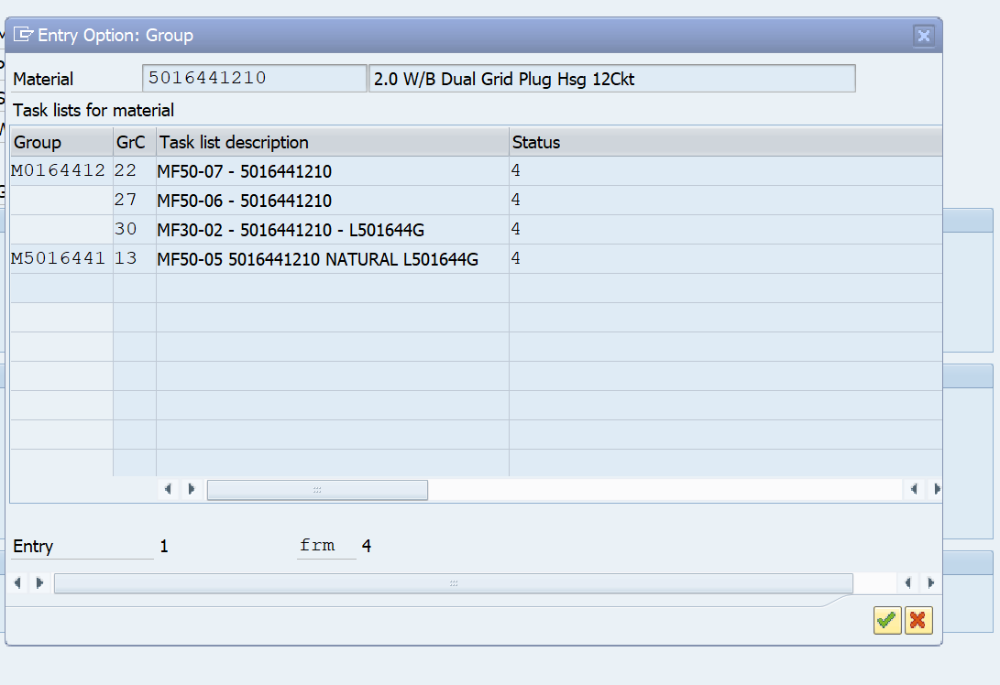
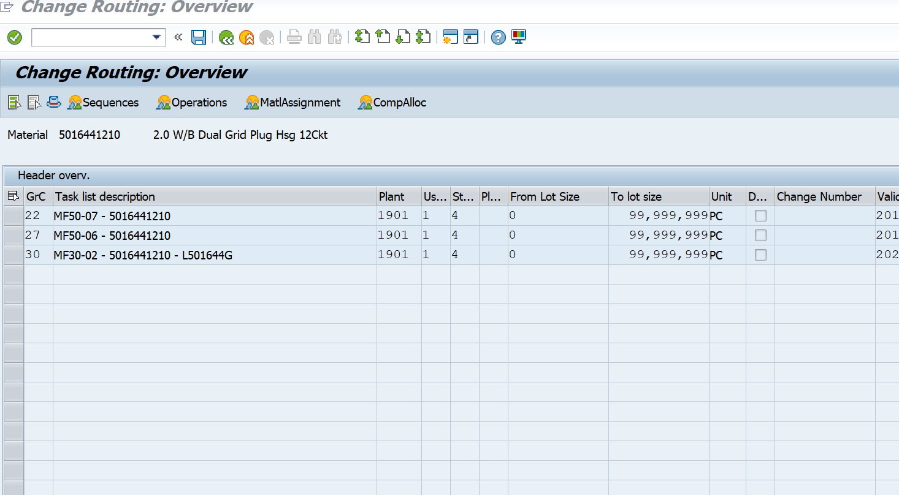

# CA02 - Assign BOM components to routings

Part of the chain create BOM -> assign -> production version: see
[`workflow.md`](workflow.md) for the phases and the shared workbook.

> **Snowflake lags SAP by ~20 minutes.** A BOM created minutes ago is not in MLX_DATALAKE
> yet. That's why there are two tasks with the same SAP logic but a different work list:
> **"newbom"** (just-created BOMs: new alt BOM from the phase 1 columns of `Sheet1`, routings from
> Snowflake) and **"altbom"** (existing BOMs: all alt BOMs and allocation from Snowflake).
> Don't run "altbom" on BOMs created less than ~20 min ago. Details: `workflow.md` 0.

For every **routing x active alternative BOM** of a list of materials, assigns the
components that are **not assigned yet** to an operation in CA02:

| Component description contains | Routing condition | Operation |
|---|---|---|
| packaging word: carton, sheet, bag, silica, bubble, box | always | **0030** |
| `LUBRICANT` | operation 0030 work center is exactly `YMHI` or `YMHI-1` | **0030** |
| anything else | - | **0020** |

The work list (routings, alt BOMs, work centers, current allocation) comes from
Snowflake (MLX_DATALAKE). Entries that don't need work are skipped and logged.
Each remaining entry is opened, assigned and saved on its own.

| File | Role |
|---|---|
| `routing_main.py` | Runner: reads the input file, builds the work list, runs SAP, writes the `Result` sheet. **Run this.** |
| `routing.py` | Rules + SAP screen steps (CA02). `python routing.py` tests one routing x alt BOM. |
| `routing_sf.py` | Snowflake queries (batched) and work list. |
| `models.py` | `Routing` dataclass (one routing x alt BOM). |
| `connect.py` | SAP session, `slow` mode. |

---

## 1. Usage

> **IMPORTANT: close the input Excel file before every run** (`check`, normal run,
> `continue`). The script writes the `Result` sheet into that file during the run.
> If the file is open in Excel, Windows locks it and saving fails
> (`Could not save ... Close it in Excel.` / `Cannot write ...`). In that case the
> SAP changes are made, but the `Result` sheet is not updated. Close the file and
> run `continue`; entries already done in SAP are found again as nothing to assign.
> Don't open the file while a run is going on; open it only after the run ends.

```powershell
cd C:\Users\nguyeb3\Downloads\SAP_automation\change_bom
python routing_main.py altbom check      # work list -> Result sheet, no SAP
python routing_main.py altbom            # work list -> Result sheet -> SAP run
python routing_main.py altbom continue   # carry on with the Result sheet (no Snowflake)
```

| Option | Meaning |
|---|---|
| `altbom` | task "altbom" (input `md_assign_component.xlsx`). Without it: task "newbom" (see 2.2) |
| *(none)* | get the work list from Snowflake, write `Result` + `Preview`, run SAP |
| `check` | get the work list from Snowflake, write `Result` + `Preview`, **stop** (no SAP) |
| `continue` | read `Result` (**no Snowflake**), process only `PENDING` and `FAILED` rows, update them in place. `retry` does the same. `Preview` is not rebuilt |
| `fresh` | rebuild the result sheet (+ `Preview`) although it already exists; SUCCESS rows of the old sheet are kept |
| `slow` | wait after every SAP action (`STEP_DELAY` in `connect.py`), to watch the run |

Options can be combined in any order, e.g. `python routing_main.py altbom continue slow`.

### Typical workflow

1. Close the input file in Excel.
2. `python routing_main.py altbom check` -> look at the `Result` sheet (what is `PENDING`, what is `SKIPPED` and why).
3. `python routing_main.py altbom continue slow` -> watch the first entries in SAP, then stop (Ctrl+C).
4. `python routing_main.py altbom continue` -> the rest.
5. Run `continue` again until no `FAILED` rows are left (or fix the cause first).

### Safety

- If `Result` already exists, a normal run **stops** and points to `continue` / `fresh`,
  so the progress of an earlier run is not overwritten by accident.
- `Result` is saved every 5 processed entries (`SAVE_EVERY`) and also when the run stops
  (Ctrl+C, crash). Entries not reached stay `PENDING`, so `continue` picks them up.
- Each save writes a temp copy first and then replaces the file, so a crash can't leave
  it half-written. The input file must be **closed in Excel** during the run.

---

## 2. Input

### 2.1 Task "altbom" (`python routing_main.py altbom ...`)

`C:\Users\nguyeb3\Downloads\md_assign_component.xlsx`, **first sheet**:

| Column | Required | Notes |
|---|---|---|
| `Material` | yes | header in row 1, data from row 2; with or without leading zeros; duplicates and blanks ignored |

Other columns are ignored. Plant (1901), routings, alt BOMs, work centers and allocation
come from Snowflake.

### 2.2 Task "newbom" (`python routing_main.py ...` without `altbom`)

Phase 2 of the chain create BOM -> assign -> production version, see
[`workflow.md`](workflow.md). Workbook `CREATE_BOM.xlsx` (`workbook.CHAIN_FILE`):
materials and the **new alt BOM** from the first sheet (`STATUS = SUCCESS`, column
`Created Alt BOM`), routings from Snowflake; result in sheet `Routing Result`
(no `Preview`). Only the new alt BOM is assigned, and its allocation is not checked in
Snowflake (the new BOM is not in MLX_DATALAKE yet, ~20 min lag): every non-deleted,
non-trial routing is opened and the screen decides.

Input files are set in `TASKS` at the top of `routing_main.py`. Sections 3 and 4.1 below
describe the task "altbom".

---

## 3. Output - `Result` and `Preview` sheets

Written into the **input file**, after the first sheet. The first sheet (the source) is
**never changed**.

### `Result` sheet

One row per **routing x alt BOM** (plus one row per material without routing / alt BOM):

| Column | Example | Meaning |
|---|---|---|
| Material | 5052760489 | |
| Group | M0527604 | routing group (PLNNR) |
| GrC | 16 | group counter (PLNAL) |
| Description | 5052760489 - MF15-17 - L505276A | routing description |
| Alt BOM | 2 | |
| Alt BOM Text | BOM 2 - REGRIND | |
| Op 0030 WC | YMHI-1 | work center of operation 0030 (lubricant rule) |
| Unassigned (Snowflake) | 5 | unassigned components when the work list was built |
| STATUS | see below | |
| MESSAGE | `0030: 3 rows (1 lubricant), 0020: 2 rows. <SAP status>` | result or reason |
| Updated At | 2026-11-12 14:05:31 | last change of this row |

| STATUS | Meaning |
|---|---|
| `PENDING` | needs assignment, not processed yet |
| `SKIPPED` | not opened in SAP, or nothing to assign on screen; reason in MESSAGE |
| `SUCCESS` | assigned and saved |
| `FAILED` | error; text in MESSAGE. Retried by `continue` |

### 3.1 `Preview` sheet (after `Result`)

Planned operation per component, **only for the `PENDING` entries** (those that will be
opened in SAP). One row per routing x alt BOM x BOM item:

| Column | Example |
|---|---|
| Material / Group / GrC / Alt BOM | 5052760489 / M0527604 / 16 / 2 |
| Op 0030 WC | YMHI-1 |
| Item / Component / Component Description | 0040 / 2027490008 / LUBRICANT HANARL MLX-79A |
| Current Operation | empty = not assigned yet, else e.g. `0020` |
| Planned | `0030 (packaging)`, `0030 (lubricant, op 0030 = YMHI-1)`, `0020`, `already 0020` |

- Built **once**, when the work list is built (`check`, normal run, `fresh`), from Snowflake
  data that is loaded anyway. No extra queries, no SAP steps.
- `continue` does **not** rebuild it (no Snowflake); it shows the plan from when the work
  list was built. `Result` shows what was actually done.
- It's the plan from the rules; the SAP run applies the same rules (`planned_operation`)
  to what it sees on screen.
- Sheet order is always: source sheet, `Result`, `Preview`.

---

## 4. Logic

### 4.1 Work list (`routing_sf.py`, `load_assignment_worklist`)

```
READ materials (first sheet of the input file)
QUERY Snowflake (batches of 500 materials):
    routings     MAPL + PLKO          active standard routings at 1901, latest change state, DELKZ
    alt BOMs     MAST + STKO          usage 1, plant 1901, latest change state (STKOZ), status 01
    op 0030 WC   PLAS + PLPO + CRHD   work center of operation 0030 per routing
    allocation   STAS + STPO + PLMZ   per routing x alt BOM x BOM item: operation ("" = not assigned)
BUILD entries = every routing x every active alt BOM of the material
FOR EACH entry: STATUS = SKIPPED (reason) or PENDING
```

### 4.2 Skip rules (`routing.py`, `skip_reason`) - first match wins

| # | Rule | MESSAGE |
|---|---|---|
| 1 | Routing deletion indicator `PLKO.DELKZ = 'X'` | `Deleted routing` |
| 2 | Routing description contains `TRIAL` (any case, covers `MDTRIAL`) | `Trial routing` |
| 3 | Alt BOM text contains `TRIAL` | `Trial alt BOM` |
| 4 | Alt BOM has no items | `No BOM items (Snowflake)` |
| 5 | All components already assigned (Snowflake) | `Already assigned (Snowflake): 3 of 3 components assigned` |
| - | Material without routing or active alt BOM | `No routing or no active alt BOM (usage 1) in MLX_DATALAKE` |

Rule 5 depends on Snowflake being up to date. The data lake can lag behind SAP; during
the run the script still checks the operation on screen before ticking a row.

### 4.3 SAP run per entry (`routing.py`, `process_routing`)

```
FOR EACH entry WITH STATUS PENDING / FAILED
    GO TO CA02, ENTER material + 1901, Enter                         Screen 1
    IF group popup THEN double-click row with Group = entry.group   Screen 2
    IF header overview THEN double-click row with GrC = entry.GrC   Screen 3
    ELSE IF group has > 1 routing (Snowflake) THEN FAILED
    ELSE log "Single routing, no header overview"
    PRESS btn[7]
    IF BOM popup THEN double-click row with AltBOM = entry.alt_bom  Screen 4
    ELSE IF material has > 1 active alt BOM THEN FAILED
    Pass 1: tick rows with empty operation AND planned 0030 -> btn[5] -> 0030 -> Enter   Screen 5
    Pass 2: tick rows with empty operation                  -> btn[5] -> 0020 -> Enter
    SAVE (also when nothing was assigned)
    SUCCESS ("0030: x rows, 0020: y rows") / SKIPPED ("No unassigned components on screen")
    on any error: FAILED + error text
END FOR
```

One CA02 entry and one save per routing x alt BOM, so a failure only affects that entry.

### 4.4 Operation per component (`routing.py`, `planned_operation`)

| # | Component description (`txt[13]`) | Routing | Operation |
|---|---|---|---|
| 1 | contains a word of `PACKAGING_WORDS` | any | 0030 |
| 2 | contains a word of `LUBRICANT_WORDS` | op 0030 WC in `LUBRICANT_0030_WORK_CENTERS` (exact) | 0030 |
| 3 | anything else | - | 0020 |

- Case-insensitive "contains": plurals match (`BOXES`, `Sheets`), but so do e.g. `toolbox`.
- Work center match is exact: `YMHI-2` ... `YMHI-27` do not count.
- Only rows with an **empty** operation (`txt[10]`) are ticked; assigned rows are never touched.
- The scan stops at the first blank row. Only **visible** rows are checked (no scrolling):
  `WARNING: table has more rows than visible` in the console means rows below were not checked.

---

## 5. SAP screens

### Screen 1 - CA02 initial screen

| Field | Element ID |
|---|---|
| Material | `wnd[0]/usr/ctxt[0]` |
| Plant | `wnd[0]/usr/ctxt[1]` |

### Screen 2 - Popup "Entry Option: Group"



Shown when the material has routings in more than one group.

- Table: `wnd[1]/usr/tblSAPLCPSLTCTRL_2110`
- Group is only filled on the first row of each group; double-clicking it opens that group.

| Column | Content | Constant |
|---|---|---|
| `ctxt[0,row]` | Group | `POPUP_GROUP_COL` |
| `txt[1,row]` | GrC | `POPUP_COUNTER_COL` |
| `txt[2,row]` | Task list description (double-clicked) | `POPUP_DESC_COL` |

### Screen 3 - Change Routing: Overview (header overview)



Lists the GrC of the selected group. Skipped by SAP when the group has only one routing.

- Table: `wnd[0]/usr/tblSAPLCPDITCTRL_1200`

| Column | Content | Constant |
|---|---|---|
| `txt[0,row]` | GrC | `HEADER_COUNTER_COL` |
| `txt[1,row]` | Task list description (double-clicked) | `HEADER_DESC_COL` |

### Screen 4 - Popup "Choose Alternative BOM" (`btn[7]`)

Opened with `wnd[0]/tbar[1]/btn[7]`. Lists all BOMs of the material (all usages):

| BOM Usg | BOM | AltBOM | Alternative Text |
|---|---|---|---|
| 1 | 01820533 | 1 | |
| 2 | 01955417 | 1 | |

- Element: `wnd[1]/usr/sub/1/txt[<row>, <column position>]`; AltBOM = `txt[row,19]` (`BOM_POPUP_ALT_COL`).
- The row is found **by value**: the first row whose AltBOM equals the entry's alt BOM is
  double-clicked. Assumes usage 1 is listed before usage 2 (as in the example).
- Popup not shown: SAP opened the only BOM directly -> OK if the material has 1 active alt BOM, else FAILED.

### Screen 5 - Component allocation

- Table: `wnd[0]/usr/tblSAPLCMDITCTRL_1000`

| Column | Content | Constant |
|---|---|---|
| `chk[0,row]` | row selection (focused before `btn[5]`) | |
| `txt[10,row]` | operation already assigned | `COMP_OPERATION_COL` |
| `txt[13,row]` | material description | `COMP_DESC_COL` |

Assign (`assign_to_operation`): focus `chk[0,<last ticked row>]` -> `wnd[0]/tbar[1]/btn[5]` ->
type operation in `wnd[1]/usr/txt[0]` -> Enter in the popup. If the popup does not open,
the entry fails with SAP's status bar text.

Save: `wnd[0]/tbar[0]/btn[11]`.

---

## 6. Settings

| Setting | File | Value |
|---|---|---|
| `TASKS` (input files, material column) | `routing_main.py` | see 2.1 / 2.2 |
| `SAVE_EVERY` | `routing_main.py` | 5 |
| `PACKAGING_WORDS` | `routing.py` | carton, sheet, bag, silica, bubble, box |
| `LUBRICANT_WORDS` | `routing.py` | lubricant |
| `LUBRICANT_0030_WORK_CENTERS` | `routing.py` | YMHI, YMHI-1 |
| `DEFAULT_OPERATION` / `PACKAGING_OPERATION` | `routing.py` | 0020 / 0030 |
| `is_trial()` | `routing.py` | text contains TRIAL |
| `BATCH_SIZE` | `routing_sf.py` | 500 materials per query |
| `STEP_DELAY` | `connect.py` | seconds per SAP action in `slow` mode |

Rules that may change later are kept in one function or constant each (`is_trial`,
`is_packaging`, `is_lubricant`, `planned_operation`, `skip_reason`), so a rule change is
a one-line edit.

---

## 7. Known limits / open points

- Component table: only visible rows are handled (no scrolling).
- BOM popup: first row with the wanted AltBOM is used, no BOM usage check (by decision).
- "Already assigned" skip relies on Snowflake; very recent changes in SAP may be missing.
- Blank-row check in Screen 5 (columns 0-9 empty) is not verified.
- `production_version.py` takes its routing list from `Routing Result` (deleted / trial skipped); a standalone production-version task would need the Snowflake path (see `workflow.md` 4).
- Screenshots for Screens 1, 4 and 5 still to add (`docs/images/`).
